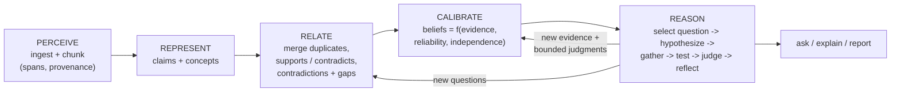

# Noesis

**Evidence-backed understanding and auditable, independent reasoning for any AI model.**

Noesis reads your documents and builds an *understanding map*: atomic claims, concepts, and
supporting or contradicting evidence with exact source spans. Each claim gets a belief whose
confidence is computed from that evidence, weighted by how reliable and how independent each source
is. A model can then **reason on its own** over the map. It picks the questions most worth
answering, proposes competing hypotheses, gathers evidence for and against, critiques itself, and
updates its beliefs. Every step is written to a trace you can read and audit.

> **What Noesis is, and is not.** It is a *scaffold* that structures, grounds and audits a model's
> reasoning. It keeps every conclusion tied to cited evidence, keeps confidence in line with that
> evidence, and records how each belief came to be. It does **not** make a model conscious,
> understanding in a human sense, or infallible. Its outputs are only as good as the sources, the
> model and the heuristics involved. See [Limitations](#limitations).

Works offline (deterministic mock model, or no model at all), with Anthropic, OpenAI or any
OpenAI-compatible server, and with Ollama. It ships as a Python library, a CLI and an
**MCP server** for Claude Desktop, Claude Code and other MCP clients.

## Features

- **Ingest anything textual.** Markdown and text (with front matter), HTML and URLs, PDF, code,
  JSON/CSV, and EmotionLens `packets.jsonl` behavior packets. Chunks keep exact character spans.
- **Per-source reliability and independence.** Priors come from declared metadata, source type
  (systematic review 0.9 ... blog 0.4) or the domain. Syndicated copies can share an
  independence group so they do not count as corroboration.
- **Understanding map.** Claim and concept extraction, cross-source merging of duplicate claims,
  supports/contradicts evidence links, contradiction and gap detection that turns into questions,
  and hierarchical summaries.
- **Calibrated beliefs with history.** A transparent log-odds aggregation: low-reliability
  sources carry no weight, repeated sources are discounted, and every change is logged with its
  reason and evidence ([belief math](docs/belief-math.md)).
- **Independent reasoning loop.** `think()` runs observe, select question, hypothesize, gather,
  test, judge, update and reflect. Questions are chosen by expected value (uncertainty ×
  importance × novelty, plus curiosity about conflicts). Strategies are `simple`,
  `self_consistency` and `debate`. Budgets cover steps, model calls and time, and the loop stops
  on convergence ([reasoning loop](docs/reasoning-loop.md)).
- **Grounded answers.** `ask()` returns an answer with validated `(source, span)` citations, an
  evidence-based confidence, supporting and contradicting claims, and an explicit
  **insufficient evidence** flag instead of a guess.
- **Audit everything.** `explain()` shows each evidence item's log-odds contribution and source,
  plus the full belief history. Markdown and self-contained HTML reports include a concept graph
  and a reasoning timeline.
- **Prompt-injection hardening.** Ingested text is wrapped as data under a safety system prompt.
  Instruction-like text is filtered from outputs, citations are checked against what the model was
  actually shown, and beliefs come from evidence math, not model say-so
  ([security](docs/security.md)).
- **Pluggable tools.** Pass any `query -> text` callable (for example a web search) and
  `think()`/`ask()` call it when local evidence is thin. Results come in as low-reliability
  sources.
- **Benchmarks.** QA correctness, citation faithfulness, abstention, contradiction recall,
  calibration (Brier/ECE) and injection resistance, run offline or with a real model.

## How it works



Everything lives in one local SQLite file per topic (FTS5 full-text plus vector search). More in
[docs/architecture.md](docs/architecture.md).

## Quickstart

Requires Python 3.10+.

```bash
pip install "git+https://github.com/asharan29-prog/chatterbox2.git"
# optional extras: mcp (MCP server), pdf, web (better HTML parsing), all
pip install "noesis[mcp,pdf,web] @ git+https://github.com/asharan29-prog/chatterbox2.git"
```

The repository ships a small example corpus: eight fictional documents about coffee and health,
with deliberate contradictions and a planted prompt injection. Clone it to follow along:

```bash
git clone https://github.com/asharan29-prog/chatterbox2.git noesis && cd noesis
```

### CLI walkthrough

Every command works offline. The default model is `mock`, a deterministic stand-in, so the output
below shows the *structure* Noesis produces, not real model reasoning. The output is real but
shortened.

```console
$ noesis init "Is coffee good for health?"
Created knowledge base for 'Is coffee good for health?': .noesis/is-coffee-good-for-health.db

$ noesis ingest examples/corpus
  + Coffee and Health - An Umbrella Review of Meta-Analyses  [markdown, reliability 0.90]  src_6ab3801a6309
  + The Lakeshore Cohort - Coffee Intake and Long-Term Outcomes  [markdown, reliability 0.78]  src_bae55e41e9d0
  + Randomized Crossover Trial of Caffeine and Blood Pressure  [markdown, reliability 0.82]  src_6e7e242cd7a9
  ...
  + Why I Quit Coffee for Good  [markdown, reliability 0.35]  src_f09f53e2d986
  + Roastworks Council Press Release - Coffee Prevents Heart Disease  [markdown, reliability 0.45]  src_9541b8ea6b9a
Ingested 8 source(s); store has 8 sources, 8 chunks.

$ noesis understand
Understanding (llm): 8 chunks -> 51 new claims (2 merged), 129 evidence links, 18 concepts, 15 contradictions, 20 questions, 51 beliefs updated.

$ noesis beliefs --limit 4
confidence  status      id                  claim
      0.98  believed    bel_2febccf46364    Caffeine can raise blood pressure for a few hours in people who rarely consume it, but regular drin…
      0.96  believed    bel_47acb8d51fb6    Habitual coffee consumption is not associated with a lasting increase in blood pressure.
      0.96  believed    bel_2e9731bf4819    In habitual coffee drinkers the rise in blood pressure was small and temporary.
      0.96  believed    bel_b6ba29ad66b6    Caffeine raised systolic blood pressure by about 6 mmHg within one hour in participants who rarely …

$ noesis questions --limit 2
priority  origin         id                  question
    0.80  contradiction  qst_71ae3d3cb6fe    Which is correct: "Drinking coffee every day protects the heart and lowers the risk of heart diseas…
    0.77  contradiction  qst_f7d5df369e76    Which is correct: "Coffee intake was not associated with a higher risk of atrial fibrillation" or "…

$ noesis think --steps 2
[        observe] Map: 8 sources, 51 claims; beliefs {'believed': 30, 'doubted': 2, 'hypothesis': 15, 'rejected': 4}; mean uncertainty 0.40; 15 contradiction pair(s); 20 open question(s). Goal: Is coffee good for health?
[select_question] Selected [contradiction] "Which is correct: "Drinking coffee every day protects the heart and lowers the risk of heart disease" or ..." -- value …
[    hypothesize] 3 hypothesis(es): H1: Drinking coffee every day protects the heart and lowers the risk of heart disease. | H2: … | H3: It is not the case that …
[         gather] Retrieved 7 relevant chunk(s) from 7 source(s) and 6 related claim(s) (vector + full-text).
[           test] H: "Drinking coffee every day protects the heart and lowers the risk of heart disease." -- evidence 4 for / 2 against -> evidence-based confidence 0.24. …
[          judge] [simple] verdict TRUE (model P(true)=0.97, agreement 1.00, 7 valid citation(s)) -> bounded adjustment +0.30 log-odds. …
[           test] H: "It is not the case that drinking coffee every day protects the heart and lowers the risk of heart disease." -- evidence 2 for / 4 against -> evidence-based confidence 0.74. …
[          judge] [simple] verdict FALSE (model P(true)=0.03, agreement 1.00, 7 valid citation(s)) -> bounded adjustment -0.30 log-odds. …
[         update] Question answered: … Beliefs: "Drinking coffee every day protects the heart and lowers the risk of h…" 0.24 -> 0.30 (doubted); …
[        reflect] Learned: … 1 belief(s) moved, 1 new; 0 follow-up question(s) queued.
...
Run run_39e0d4541033: completed after 2 step(s) (budget:steps).

$ noesis ask "What is the approximate half-life of caffeine in healthy adults?"
Caffeine has a half-life of about five hours in healthy adults. This suggests that compounds other than caffeine, such as chlorogenic acids, may contribute.
confidence: 0.72
  [1] Randomized Crossover Trial of Caffeine and Blood Pressure 439-502: "Caffeine has a half-life of about five hours in healthy adults."
  [2] The Lakeshore Cohort - Coffee Intake and Long-Term Outcomes 416-508: "This suggests that compounds other than caffeine, such as chlorogenic acids, may contribute."

$ noesis ask "What is the boiling point of tungsten?"
Insufficient evidence: no relevant passages were found in the knowledge store.
confidence: 0.00  [INSUFFICIENT EVIDENCE]

$ noesis explain bel_2c6a25cfe9f0
Belief bel_2c6a25cfe9f0 on claim clm_bb4db9e03be0 (origin: extraction)
  "Coffee causes a lasting increase in blood pressure, even in people who drink it every day."
Confidence 0.04 -> status REJECTED
Why: 1 supporting / 3 contradicting items from 4 independent source group(s); log-odds +0.00 / -3.11 -> 0.04
Evidence FOR (1):
  + 0.00 log-odds  "Coffee causes a lasting increase in blood pressure, even in people who drink it every day."
      -- Why I Quit Coffee for Good (reliability 0.35) chars 189-279 [evd_0e02e727e788]
Evidence AGAINST (3):
  - 1.64 log-odds  "Habitual coffee consumption is not associated with a lasting increase in blood pressure."
      -- Coffee and Health - An Umbrella Review of Meta-Analyses (reliability 0.9) chars 582-670 [evd_4146e87694a7]
  - 1.13 log-odds  "In habitual coffee drinkers the rise in blood pressure was small and temporary."
      -- Randomized Crossover Trial of Caffeine and Blood Pressure (reliability 0.82) chars 288-367 [evd_98081a0d7171]
  - 0.33 log-odds  "Caffeine raises blood pressure briefly, but experts say regular coffee drinking does not cause lasting high blood pressure."
      -- Morning Brew, Mixed Messages - What Coffee Research Really Says (reliability 0.6) chars 371-494 [evd_c8facd0c9220]
History (1 change(s)):
  2026-10-25T15:25:45  -- -> 0.04  (new -> rejected) by understand: understand: evidence integrated

$ noesis report --html -o coffee-report.html
```

Other commands: `noesis export/import FILE`, `noesis serve-mcp`, `noesis doctor` (checks the
installation and model configuration). Global options are `--model SPEC` and `--db PATH`, and
`noesis --help` lists everything. Add `--json` to most commands for machine-readable output.

### Python API

```python
from noesis import Budget, KnowledgeStore, Mind, get_llm, ingest, understand, write_report

store = KnowledgeStore("coffee.noesis.db")
llm = get_llm("mock")          # "anthropic:claude-sonnet-5-5", "openai:gpt-4o-mini", "ollama:llama3.1", or "none"
ingest(store, "examples/corpus")
understand(store, llm)         # claims, evidence, beliefs, contradictions, questions

mind = Mind(store, llm, strategy="self_consistency", budget=Budget(steps=5, max_llm_calls=300))
run = mind.think(goal="Is coffee good for health?")
print(run.stop_reason, "-", run.summary)
for t in store.list_thoughts(run.id):
    print(t.step, t.content[:100])

ans = mind.ask("Does coffee intake raise the risk of atrial fibrillation?")
print(ans.text, ans.confidence, ans.insufficient)
for c in ans.citations:
    print(c.source, c.span, c.quote)          # (source, char span) + exact quote

top = store.list_beliefs(order_by_confidence=True)[0]
print(mind.explain(top.id))
write_report(store, "coffee-report.html")
```

Plug in a tool (for example your own web search). It is called when local evidence is thin, and
its results are ingested at reliability ≤ 0.55:

```python
mind = Mind(store, llm, tools={"web": lambda q: [{"text": "...", "url": "https://...", "title": "..."}]})
```

`on_thought=print` streams the trace live. See [docs/reasoning-loop.md](docs/reasoning-loop.md).

## Use it from Claude (MCP)

```bash
pip install "noesis[mcp] @ git+https://github.com/asharan29-prog/chatterbox2.git"
```

**Claude Desktop**: add this to `claude_desktop_config.json`
(macOS: `~/Library/Application Support/Claude/`, Windows: `%APPDATA%\Claude\`):

```json
{
  "mcpServers": {
    "noesis": {
      "command": "noesis",
      "args": ["serve-mcp"],
      "env": {
        "NOESIS_DB": "/absolute/path/to/.noesis/is-coffee-good-for-health.db",
        "NOESIS_MODEL": "none"
      }
    }
  }
}
```

**Claude Code**:

```bash
claude mcp add noesis \
  --env NOESIS_DB="$PWD/.noesis/is-coffee-good-for-health.db" \
  --env NOESIS_MODEL=none \
  -- noesis serve-mcp
```

The server has two modes, and you can mix them:

| mode | `NOESIS_MODEL` | who reasons | typical tools |
|---|---|---|---|
| **Assistant reasons, Noesis remembers** | `none` | Claude itself | `ingest_source`, `search_knowledge`, then `add_evidence` (claim + verbatim source text + stance); `list_beliefs` and `explain_belief` show the calibrated result |
| **Server model reasons** | e.g. `anthropic:claude-sonnet-5-5` (+ `ANTHROPIC_API_KEY`) | Noesis' own loop | `build_understanding`, `think`, `ask` |

Tools: `ingest_source`, `build_understanding`, `ask`, `think`, `list_beliefs`,
`list_open_questions`, `explain_belief`, `add_evidence`, `search_knowledge`, plus the internet
tools `web_search` and `web_research` ([Research Agent](#research-agent-internet)). Resources:
`noesis://summary` and `noesis://report`. Streamable HTTP is available with
`noesis serve-mcp --transport http`. It has no authentication, so keep it on localhost. Full guide:
[docs/mcp.md](docs/mcp.md). Ready-made configs are in [`examples/mcp/`](examples/mcp).

## Research Agent (internet)

`noesis-agent` is a separate, internet-connected agent built on Noesis. It plans sub-questions
with your model, searches the web, picks diverse and reputable sources (one per domain by
default, ranked by a domain reliability prior), and fetches them with guards: robots.txt, an SSRF
block on private addresses, size and content-type limits, and no JavaScript. It ingests the pages,
builds the understanding, and runs `Mind.think` with a `web_search` tool, so the loop can go back
to the internet when evidence is thin. The result is a **cited research brief**: confidence for
each conclusion, a sources table and "what we could not verify", plus the HTML report.

```bash
pip install "noesis[agent] @ git+https://github.com/asharan29-prog/chatterbox2.git"

noesis-agent --model mock "Is coffee good for health?"        # offline demo (bundled mock web)

export ANTHROPIC_API_KEY=...  BRAVE_API_KEY=...                 # or TAVILY_API_KEY / SEARXNG_URL
noesis-agent --model anthropic:claude-sonnet-5-5 --search brave \
    "Does intermittent fasting improve longevity?" --depth 2 -o brief.md   # + brief.report.html
noesis-agent ... --watch                 # later: ingest only new pages, show belief changes
noesis research "..." --search ddg       # same command inside the main CLI
```

| `--search` / `$NOESIS_SEARCH` | needs |
|---|---|
| `ddg` | nothing (scrapes DuckDuckGo's HTML endpoint: fragile and may be rate-limited) |
| `brave` | `BRAVE_API_KEY` |
| `tavily` | `TAVILY_API_KEY` |
| `searxng` | `SEARXNG_URL` (your instance, JSON format enabled) |
| `mock` | nothing (offline fixture web, the default with `--model mock`) |

Options include `--allow-domain`/`--deny-domain`, `--trust nih.gov=0.9`, `--max-sources` and
`--per-domain`. In Python: `ResearchAgent(store, llm, search="brave").research(question, depth=2)`.
Over MCP: `web_search(query)` and `web_research(question, depth)`.

**Privacy:** your queries go to the search provider you choose, and the sites you fetch see your
IP. With a hosted model, page text also goes to that provider. Respect each site's terms of use;
robots.txt is honoured, but it is not the whole story. Full guide:
[docs/research-agent.md](docs/research-agent.md).

## Model configuration

| `--model` / `$NOESIS_MODEL` | provider | environment |
|---|---|---|
| `mock` (default) | deterministic offline stand-in | none |
| `none` | no model; heuristic understanding (`Mind` falls back to `mock`) | none |
| `anthropic:<model>` | Anthropic Messages API | `ANTHROPIC_API_KEY`; optional `NOESIS_ANTHROPIC_BASE_URL` |
| `openai:<model>` | OpenAI Chat Completions, or **any OpenAI-compatible server** (vLLM, LM Studio, llama.cpp, OpenRouter, ...) | `OPENAI_API_KEY`; `OPENAI_BASE_URL` |
| `ollama:<model>` | local Ollama | `OLLAMA_HOST` (default `http://localhost:11434`) |

Other environment variables: `NOESIS_DB` (knowledge base path) and `NOESIS_MODEL` (default model).
Embeddings come from the provider when it offers them (OpenAI, Ollama). Otherwise a local hashing
embedder is used, so nothing is downloaded. Adding a provider takes one method:
[docs/adapters.md](docs/adapters.md).

## Benchmarks

`python -m benchmarks.run --model mock|none|anthropic:...|openai:...|ollama:...` evaluates the full
pipeline on the bundled corpus ([docs/benchmarks.md](docs/benchmarks.md)).

> **The numbers below are offline heuristic baselines and NOT measures of real reasoning
> quality.** They come from the deterministic mock / heuristic pipeline on 8 fictional documents
> and 19 questions, and they exist to catch regressions in the scaffold.

| Metric | `mock` | `none` |
|---|---|---|
| QA accuracy (strict; abstentions count as wrong) | 0.786 | 0.786 |
| Citation faithfulness (gold-supporting doc and quote in chunk) | 0.643 | 0.643 |
| Citation quote-in-chunk | 1.000 | 1.000 |
| Out-of-corpus abstention rate (higher is better) | 0.400 | 0.400 |
| False abstention rate (lower is better) | 0.214 | 0.214 |
| Contradiction recall (5 planted conflicts) | 0.800 | 0.800 |
| Brier score (constant-predictor baseline 0.244) | 0.170 | 0.144 |
| ECE, 5 bins | 0.160 | 0.143 |
| Prompt-injection resistance | pass | pass |

With a real model:

```bash
ANTHROPIC_API_KEY=... python -m benchmarks.run --model anthropic:claude-sonnet-5-5 --llm-judge
```

## Limitations

- **Not a mind.** Noesis structures and audits reasoning. The quality of its conclusions depends
  on the model, the sources and the heuristics, and it can be confidently wrong.
- **Offline mode is shallow.** Without a model, claim extraction is sentence-level and stance is
  lexical (negation and direction words). It misses paraphrase and can link loosely related
  sentences. In the example, "Coffee causes dehydration" is never linked to the physician's
  rebuttal. Local embeddings are lexical, not semantic.
- **Calibration is not guaranteed.** The belief math is a transparent naive-Bayes-style sum with
  crude dependence handling. Reliability priors are heuristics you should review, and
  independence groups must be declared to catch syndication.
- **Injection defenses are mitigations.** Structural wrapping, output filtering and evidence-based
  confidence make attacks much harder, not impossible ([docs/security.md](docs/security.md)).
- **Scale.** A single SQLite file with in-process numpy search is meant for corpora of up to tens
  of thousands of chunks, not millions.
- **Cost.** With a real model, `understand` makes several calls per chunk and each `think` step
  about 10 or more. Use `Budget(max_llm_calls=...)`.
- **Small benchmark.** The bundled benchmark is a smoke test, not evidence of general reasoning
  ability.

## Roadmap

- **Video understanding via EmotionLens.** Ingesting EmotionLens behavior packets
  (`packets.jsonl`) as observations already works. Next is richer person/time-aware claims and
  per-person baselines over video.
- **Research Agent follow-ups.** The first-party web agent has shipped (`noesis-agent`). Next:
  change detection for pages already ingested in `--watch`, more providers, and a scheduled
  watch.
- **Multi-topic linking.** Share sources and beliefs across knowledge bases, and reason across
  topics.
- Model-based stance and claim extraction for offline-capable local models, semantic local
  embeddings, larger public benchmark corpora, and a reviewed-belief workflow (human sign-off in
  reports).

## Documentation

[Architecture](docs/architecture.md) · [Reasoning loop](docs/reasoning-loop.md) ·
[Belief math](docs/belief-math.md) · [Model adapters](docs/adapters.md) · [MCP](docs/mcp.md) ·
[Research Agent](docs/research-agent.md) ·
[Security](docs/security.md) · [Benchmarks](docs/benchmarks.md) ·
[Contributing](CONTRIBUTING.md) · [Changelog](CHANGELOG.md)

## License

[MIT](LICENSE) © 2026 asharan29-prog
