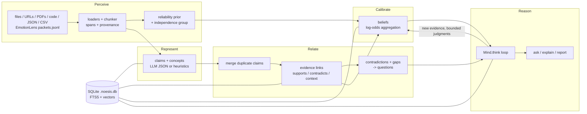

# Architecture

Noesis turns a pile of documents into a **structured, evidence-backed understanding map**. It then
runs an **auditable reasoning loop** over that map with any language model, or with none. Every
belief it holds can be traced back to source spans. Every reasoning step is persisted.

The design came out of earlier work on behavior understanding (EmotionLens). Two ideas carried
over. Understanding should be *layered* (perceive, represent, relate, contextualize, integrate,
calibrate, test). And the single biggest accuracy gain came from a *per-source baseline*, which here
is a per-source reliability prior.

## Modules

| Layer | Module | Responsibility |
|---|---|---|
| Data model | `noesis/types.py` | Pydantic v2 models: `Source`, `Chunk`, `Concept`, `Claim`, `Evidence`, `Belief` (+ `BeliefChange` history), `Question`, `Thought`, `ReasoningRun`, `Summary`. Ids are prefixed (`src_`, `chk_`, `clm_`, `evd_`, `bel_`, `qst_`, `thg_`, `run_`). |
| Storage | `noesis/store.py` | `KnowledgeStore`: one SQLite file per topic. Each model type is a JSON table with indexed columns, plus an FTS5 virtual table for full-text search, a `vectors` table (float32 blobs per namespace) with numpy cosine search, a `meta` table, and JSON export/import. |
| Perceive | `noesis/ingest/` | Loaders for text/markdown (YAML-ish front matter), HTML/URL (httpx, plus bs4 if installed), PDF (pypdf), code, JSON/CSV, and EmotionLens `packets.jsonl` (behavior packets become observation sentences). The chunker packs paragraphs up to ~1200 chars and keeps exact `(start, end)` spans into the source text. `reliability.py` holds the priors. |
| Represent / relate | `noesis/understand.py`, `noesis/nlp.py`, `noesis/embed.py` | Builds the map; see below. `nlp.py` is the offline toolkit (sentence/clause splitting, TF-IDF, negation and direction polarity, lexical stance). `embed.py` provides provider embeddings when available, otherwise a stable local feature-hashing embedder, plus `hybrid_search`. |
| Calibrate | `noesis/beliefs.py` | Evidence becomes confidence and status, with an audit trail. See [belief-math.md](belief-math.md). |
| Reason | `noesis/reason/` | `Mind` (think / ask / explain), question selection, strategies, budgets, citation validation and the injection filter. See [reasoning-loop.md](reasoning-loop.md). |
| Models | `noesis/llm/` | `LLM` protocol, `BaseLLM` (JSON mode with repair retries, usage accounting), adapters, `MockLLM`, prompt construction with safety wrapping. See [adapters.md](adapters.md). |
| Interfaces | `noesis/cli.py`, `noesis/mcp_server.py`, `noesis/report.py` | Argparse CLI, MCP server (stdio / streamable HTTP), markdown + self-contained HTML reports. See [mcp.md](mcp.md). |

## Perceive: sources and reliability

Each `Source` gets a **reliability** `r`: the prior probability that a claim it asserts is correct.
The first rule that applies wins:

1. an explicit `reliability:` in front matter or metadata (or a later user override via
   `KnowledgeStore.set_source_reliability`);
2. `source_type:` mapped through `KIND_PRIORS`. For example: systematic_review / meta_analysis 0.9,
   peer_reviewed / rct / clinical_trial 0.82, government 0.8, cohort_study 0.78, expert_qa 0.7,
   news 0.6, press_release / industry 0.45, blog / opinion 0.4, forum / social 0.3;
3. URL domain rules. For example: Cochrane 0.9, NIH/WHO/CDC 0.85, `.gov` 0.82, major journals 0.82,
   `.edu` 0.78, Wikipedia 0.7, arXiv 0.68, major news 0.65, blog platforms 0.4, social media 0.3.
   Any other web domain gets 0.55;
4. otherwise 0.6.

Sources can share an **independence group** (`independence_group:` in front matter). For example, a
press release and the news story that rewrites it. Evidence from one group is discounted so that
syndication does not count as corroboration ([belief-math.md](belief-math.md#duplicate-source-discount)).

## Represent, relate, calibrate: `understand(store, llm)`

The pipeline is incremental. Only chunks not yet marked as understood are processed.

1. **Extract**: per chunk, claims (with quote spans) and concepts. With a model this is the
   `extract_claims` JSON task. Offline (`llm=None`) it uses heuristic sentence-level claims and
   noun-phrase concepts.
2. **Integrate**: a candidate claim is merged into an existing one when TF-IDF similarity is at
   least `merge_threshold` (0.6) and polarity matches. With a model, the ambiguous band
   [0.4, 0.6) is checked with a `same_claim` call. The asserting chunk becomes `supports` evidence
   with `relation="asserted"`.
3. **Relate**: cross-source evidence linking. For new claims × all chunks, and old claims × new
   chunks, that are lexically or vectorially close (`link_min_sim` 0.12, top `link_top_k` 6), it
   classifies stance with the model (`classify_stance`) or `nlp.lexical_stance`. The offline
   classifier picks the best-overlapping clause pair and compares negation parity and directional
   words (higher/lower, increase/decrease). Links weaker than `min_evidence_strength` (0.45) are
   dropped. Stance checks are capped per run (`max_stance_checks` 600) for cost control.
4. **Calibrate**: recompute beliefs for touched claims.
5. **Abstract**: concept hierarchy and RAPTOR-style summaries (level 0 per concept, level 1 for the
   topic).
6. **Question**: up to 20 new `Question` rows per run.
   - **Contradiction pairs** become "Which is correct: A or B?" with priority 0.6 + 0.4 × max
     uncertainty. A pair is lexically close claims of opposite polarity, or a claim whose
     asserting sentence was linked as contradicting another claim.
   - **Contested claims** (evidence on both sides) become "Is it true that ...?" with origin
     `contradiction`.
   - **Single-source claims** with confidence in (0.3, 0.8) become "Is there independent evidence
     that ...?" with origin `gap`.
   - **Concepts** mentioned in two or more chunks but with no claims become "What is known about
     X?" with origin `gap`.

## Reason

`Mind(store, llm)` reads and writes the same store. `think()` picks questions by expected value,
generates competing hypotheses, gathers evidence by hybrid retrieval, links it, critiques, judges,
updates beliefs, and reflects. `ask()` answers one question with validated citations. `explain()`
prints the full evidence chain and history for a belief. Every phase is written as a `Thought`
tied to a `ReasoningRun`. Details are in [reasoning-loop.md](reasoning-loop.md).

## Retrieval

`hybrid_search(store, query, kind="chunk"|"claim")` blends vector cosine (weight `alpha` = 0.6) with
rank-normalized FTS5 BM25 scores into [0, 1]. The reasoning engine treats hits scoring at least
`min_relevance` (0.12) as relevant, and breaks ties by item text for determinism. Vectors are
namespaced by embedder (`chunk:<embedder>`), so switching providers never mixes incompatible
vectors. The local hashing embedder is lexical, not semantic. It is good enough for small corpora;
use a provider with embeddings for larger ones.

## Design invariants

- **Provenance**: a claim is never trusted on its own. Confidence comes only from `Evidence` rows
  (chunk + span + quote) and a small, bounded, logged adjustment term.
- **History**: every belief change appends a `BeliefChange` (old/new confidence and status, reason,
  actor, evidence ids).
- **Untrusted text**: anything ingested is wrapped as data in prompts, and instruction-like output
  is filtered out ([security.md](security.md)).
- **Determinism**: with `MockLLM`, runs are reproducible (seeded sampling, text-ordered ties).
- **Offline first**: the whole pipeline works with `--model mock` or `--model none`. Real models
  make it better, not possible.
