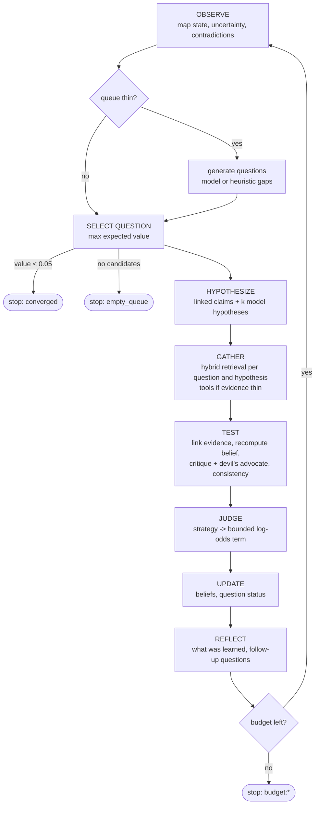

# The reasoning loop

Source: `noesis/reason/` (`mind.py`, `selection.py`, `strategies.py`, `budget.py`, `citations.py`,
`safety.py`). The defaults quoted here are in `MindConfig` and `SelectionConfig`.

```python
from noesis import Mind, Budget
mind = Mind(store, llm, strategy="simple" | "self_consistency" | "debate",
            budget=Budget(steps=5, max_llm_calls=None, seconds=None),
            tools={"web": my_search_fn}, on_thought=print)
run = mind.think(goal="Is coffee good for health?")   # -> ReasoningRun (persisted)
ans = mind.ask("Does coffee raise blood pressure?")   # -> Answer (citations, confidence, trace)
print(mind.explain(belief_id))                        # evidence chain + history
```



Each phase emits a `Thought` (`observe`, `generate_questions`, `select_question`, `hypothesize`,
`gather`, `test`, `judge`, `update`, `reflect`, `answer`, `note`). Each thought carries refs to the
claims, evidence, chunks and questions it touched, plus structured metadata (scores, judgments,
adjustments). Thoughts are persisted to the store and streamed to `on_thought`. The CLI prints them
live during `noesis think`.

## 1. OBSERVE

Ensures the chunk and claim vector indexes are current. Then it summarizes the map: claim count,
belief status histogram, mean uncertainty `1 - |2p - 1|`, number of contradiction pairs, open
questions, and the five most uncertain claims.

## 2. Question generation (when the queue is thin)

If fewer than `min_queue` (2) questions are open, the model is shown the 8 most uncertain claims and
the recently asked questions, and asked for up to `max_new_questions` (5) new ones (origin
`curiosity`). If that yields nothing, Noesis falls back to "Is it true that ...?" for the three most
uncertain claims (origin `gap`). Questions that are too short, near-duplicates (similarity ≥ 0.85)
or look like injected instructions are rejected.

## 3. SELECT QUESTION

Every open, non-duplicate question is scored:

```
value = uncertainty × importance × novelty + curiosity_bonus
```

- **uncertainty**: the mean of `1 - |2p - 1|` over the beliefs of the question's linked claims. If
  no claims are linked, the uncertainty of its last answer confidence is used, else 0.8.
- **importance**: `0.6·priority + 0.25·min(1, 2·goal_relevance) + 0.15·centrality` when a goal is
  set (goal relevance is TF-IDF similarity). Without a goal, `(0.6·priority + 0.15·centrality)/0.75`.
  The result is clamped to [0.05, 1]. Centrality is `log1p(n) / log1p(max n)`, where n counts the
  non-context evidence on the question's claims.
- **novelty**: `1 - max similarity` to questions already asked in this run or already resolved.
  It is multiplied by `0.5^attempts` (earlier inconclusive attempts) and by 0.3 if the question was
  already picked in this run.
- **curiosity bonus**: contradiction +0.15, gap +0.10, curiosity +0.05, user 0. The bonus is
  multiplied by uncertainty, so settled conflicts stop attracting attention, and faded when
  novelty is below 0.2.

The highest value wins. Ties break on an order-insensitive form of the text, for determinism. The
runners-up are logged with their scores.

## 4. HYPOTHESIZE

Candidate answers are the question's linked claims (up to max(k, 2)), topped up to
`k_hypotheses` (3) by the model's `generate_hypotheses` task over the retrieved passages.
Duplicates and instruction-like text are dropped. As a last resort the question is turned into a
declarative claim. Several competing hypotheses are tested side by side, so the loop is not just
confirming its first idea.

## 5. GATHER

Hybrid retrieval (vector cosine + FTS5 BM25, see [architecture.md](architecture.md#retrieval)) runs
for the question (top `retrieve_k` = 6) and for each hypothesis. Chunks scoring at least
`min_relevance` (0.12) are kept, plus up to `claim_k` (6) related claims. If fewer than
`tool_trigger_hits` (2) relevant chunks were found and **tools** are configured, each tool is called
with the question, up to `max_tool_calls` (3) per run. A tool is any callable that takes a query
string and returns `str`, `dict(text, title?, url?, reliability?)` or a list of these. Results are
ingested as new sources with reliability capped at `tool_reliability` (0.55), so they are weak
evidence until corroborated.

## 6. TEST

For each hypothesis:

1. Find or create its `Claim`. A new one has origin `hypothesis`.
2. **Link evidence** from the gathered chunks only (the same stance classifier as `understand`) and
   **recompute the belief** from all of its evidence. This is the *evidence-based confidence*.
3. Run **critique** (arguments for and against) and the **devil's advocate** (the strongest
   counterargument), both grounded in up to `max_docs` (8) retrieved passages. Their citations are
   validated, as everywhere else.
4. Check **consistency** against held beliefs (confidence ≥ 0.6) among related claims. A lexical
   contradiction is recorded on both claims (`metadata["contradicts"]`). If both sides are
   currently held (≥ 0.6), a new "Which is correct: A or B?" contradiction question is queued.
5. A **newly created hypothesis with no supporting or contradicting evidence is discarded**, so the
   map is not cluttered with untestable ideas.

## 7. JUDGE (strategies)

A strategy turns (claim, documents) into a `Judgment` (verdict true/false/uncertain, model
P(true), agreement, validated citations). The judgment becomes a **small, bounded,
replaced-not-accumulated** log-odds term ([belief-math.md](belief-math.md#judgment-term-reasoning-engine)).
Evidence always dominates.

| strategy | what it does | agreement |
|---|---|---|
| `simple` | one `judge` call at temperature 0 | 1 |
| `self_consistency` | k = `sc_samples` (3) judgments. The first sees all documents at T = 0, the rest a seeded bootstrap subset (70% of documents) at T = 0.7. Majority vote, with a tie giving `uncertain`. | majority share |
| `debate` | a pro advocate and a con advocate argue from the evidence, then a judge rules with both arguments in view | 1 if the verdict sides with the advocate who had more valid citations, else 0.5 |

Sampling uses a per-hypothesis seeded RNG, so results do not depend on visiting order.

## 8. UPDATE

The best live hypothesis decides the question:

- confidence ≥ `resolve_confidence` (0.75): the question is **answered** (answer text and confidence
  stored);
- otherwise, after `max_attempts` (3) inconclusive attempts: **dropped**;
- otherwise: back to **open**, with its attempt count raised (which lowers its novelty).

## 9. REFLECT

The model summarizes what was learned and proposes up to 3 follow-up questions (origin
`curiosity`). Heuristically, any hypothesis left uncertain (0.35 to 0.75) that rests on a single
independent source group triggers "Is there independent evidence that ...?" (origin `gap`).

## Stop rules

Checked before each step, and mid-step for call and time limits:

| stop reason | condition | run status |
|---|---|---|
| `budget:steps` | `Budget.steps` iterations done | completed |
| `budget:llm_calls` | `Budget.max_llm_calls` reached (JSON repair retries and evidence-linking stance checks count) | stopped |
| `budget:seconds` | wall-clock limit reached | stopped |
| `empty_queue` | no open, non-duplicate questions | completed |
| `converged` | best question value < `min_value` (0.05) | completed |

A budget hit mid-step raises `BudgetExceeded`. This is deliberately *not* an `LLMError`, so it is
not swallowed by heuristic fallbacks. Any in-progress question is released back to `open`. The run
records its usage (LLM calls, steps, seconds, dropped citations, tool calls), the per-question
outcomes, the belief changes and a one-line summary.

## `ask(question)`

1. Retrieve up to `max_docs` (8) chunks. Keep those ≥ 0.12, and call tools if evidence is thin. If
   nothing is relevant, return **"Insufficient evidence"** with confidence 0.
2. The model answers from the wrapped passages (`answer_question`). Instruction-like sentences are
   stripped from the answer and noted. Citations are validated against the chunk ids that were
   shown. Invalid ones are dropped and counted.
3. Related claims in the map are classified (lexical stance against the answer) as supporting or
   contradicting.
4. **Confidence is evidence-based.** The model's self-report is a 20% input:

   ```
   coverage    = min(1, valid_citations / 2)
   ev_conf     = relevance-weighted mean belief confidence of the top-3 supporting claims
                 (or 0.4 · coverage if no supporting claim)
   contra_conf = max confidence among contradicting claims with confidence ≥ 0.5 (else 0)
   confidence  = (0.8 · ev_conf · (0.5 + 0.5·coverage) + 0.2 · model_conf) · (1 - 0.5 · contra_conf)
   ```

5. The answer is flagged **insufficient** when it has no text or no valid citation (confidence is
   then capped at 0.2 and the ungrounded answer is withheld), or when confidence <
   `answer_min_confidence` (0.35). In that case the text is prefixed "Insufficient evidence for a
   confident answer ... Tentatively: ...". An insufficiently answered question stays open, so a
   later `think()` can pursue it.

Each citation resolves to `(source, span)` plus the best-matching quote sentence inside the cited
chunk (`Answer.citation_pairs`).

## `explain(belief_id)`

Prints the claim, confidence and status, the aggregation rationale, each evidence item for and
against (log-odds contribution, source and reliability, character span, duplicate-source discount),
context-only evidence, the judgment/user adjustment, the full confidence history, and the reasoning
thoughts that referenced the claim. `explain_data()` returns the same information as a dict.

## Using your own model as the reasoner (MCP)

Through MCP, the *calling assistant* can do steps 3 to 9 itself. It reads with `search_knowledge`
and records conclusions with `add_evidence` (claim + exact source text + stance). Noesis then
handles only provenance, aggregation and history. See [mcp.md](mcp.md).
