# Noesis Research Agent

The Research Agent is a separate, internet-connected agent built on top of Noesis. It combines
three things:

- **a model**: any Noesis adapter (`anthropic:`, `openai:`, `ollama:`, or `mock` offline);
- **web tools**: a search provider and a guarded page fetcher;
- **the Noesis engine**: ingestion with reliability priors, the understanding map, calibrated
  beliefs and the `Mind` reasoning loop.

You give it a question. It returns a **cited research brief** in markdown, with a confidence for
each conclusion, a sources table and an explicit "what we could not verify" section. It also
writes the standard Noesis HTML report. Source: `noesis/agent/` (`web.py`, `research.py`,
`cli.py`, `service.py`, `mockweb.py`).

```mermaid
flowchart LR
    Q[question] --> P[plan sub-questions<br/>model]
    P --> S[search each<br/>ddg / brave / tavily / searxng]
    S --> SEL[select sources<br/>reliability prior, 1 per domain,<br/>allow/deny lists]
    SEL --> F[fetch<br/>robots.txt, SSRF guard,<br/>size/type limits]
    F --> I[ingest<br/>domain reliability prior]
    I --> U[understand<br/>claims, evidence, contradictions]
    U --> T[Mind.think<br/>web_search tool when evidence is thin]
    T --> A[ask main + sub-questions]
    A --> B[brief.md + report.html]
```



## Setup

```bash
pip install "noesis[agent] @ git+https://github.com/asharan29-prog/chatterbox2.git"
```

The `agent` extra adds BeautifulSoup for HTML parsing. `httpx` is already a core dependency. Add
`pdf` if you want PDF pages read as well.

Pick a search provider with `--search` or `$NOESIS_SEARCH`:

| provider | key / setting | notes |
|---|---|---|
| `ddg` (default with a real model) | none | Scrapes DuckDuckGo's no-JavaScript HTML endpoint. **Fragile**: the markup can change at any time, and automated clients may be rate-limited or shown a bot challenge (reported as an error). Fine for trying things out; use a keyed API for regular use. |
| `brave` | `BRAVE_API_KEY` | [Brave Search API](https://brave.com/search/api/) |
| `tavily` | `TAVILY_API_KEY` | [Tavily](https://tavily.com) |
| `searxng` | `SEARXNG_URL` (e.g. `http://localhost:8888`) | Your own [SearXNG](https://docs.searxng.org) instance. Enable JSON output: `search.formats: [html, json]` in `settings.yml`. |
| `mock` (default with `--model mock`) | none | The bundled offline fixture web, for demos and tests. It is **not** the internet. |

The model is chosen as usual with `--model` or `$NOESIS_MODEL` (see [adapters.md](adapters.md)).

## Command line

```bash
# offline demo: mock model + mock web, no network
noesis-agent --model mock "Is coffee good for health?"

# real research
export ANTHROPIC_API_KEY=... BRAVE_API_KEY=...
noesis-agent --model anthropic:claude-sonnet-5-5 --search brave \
    "Does intermittent fasting improve longevity?" --depth 2 -o brief.md
#  -> brief.md (cited brief) + brief.report.html (full Noesis report)

# the same inside the main CLI
noesis --model openai:gpt-4o-mini research "Is nuclear power safer than wind?" --search tavily -o brief.md

# later: re-run the saved searches, ingest only new pages, show which beliefs moved
noesis-agent --model anthropic:claude-sonnet-5-5 --search brave "Does intermittent fasting improve longevity?" --watch
```

| option | meaning |
|---|---|
| `--depth 1..5` | number of sub-questions (`1 + depth`, at most 6) and reasoning steps (`2 × depth`) |
| `--search` | `ddg`, `brave`, `tavily`, `searxng` or `mock` |
| `--max-sources N` | pages fetched up front (default 8). The reasoning loop may add a few more. |
| `--per-domain N` | at most N sources per registrable domain (default 1), for diversity |
| `--allow-domain D` | whitelist: only these domains (and their subdomains). Repeatable. |
| `--deny-domain D` | never use these domains. Repeatable. |
| `--trust D=R` | reliability override for a domain, e.g. `--trust mylab.org=0.9` |
| `--min-reliability R` | skip results whose prior is below R (default 0.35; content farms sit at 0.3) |
| `--steps`, `--strategy`, `--max-llm-calls`, `--seconds` | reasoning budget, as for `noesis think` |
| `-o FILE`, `--no-html` | write the brief (and `FILE-stem.report.html`) |
| `--watch` | incremental refresh instead of a new research run |
| `--json` | the whole result as JSON |
| `--no-cache`, `--cache-dir` | web cache control (default `.noesis/webcache`, 7-day TTL) |

The knowledge base is `--db`, else `$NOESIS_DB`, else `./.noesis/research-<question-slug>.db`.
Each question gets its own file, so re-running or `--watch` builds on what was already learned.

## Python API

```python
from noesis import KnowledgeStore, get_llm
from noesis.agent import DomainPolicy, ResearchAgent, ResearchBudget

agent = ResearchAgent(
    KnowledgeStore("fasting.db"),
    get_llm("anthropic:claude-sonnet-5-5"),
    search="brave",                                   # or a WebToolkit
    budget=ResearchBudget(max_sources=10, per_domain=1, max_llm_calls=400),
    policy=DomainPolicy(deny=["pinterest.com"], trust={"cochranelibrary.com": 0.92}),
    on_event=print,                                   # progress lines
)
result = agent.research("Does intermittent fasting improve longevity?", depth=2)
print(result.main.answer, result.main.confidence, result.main.citations)
for c in result.conclusions:      # one per sub-question
    print(c.question, c.confidence, c.citations, c.insufficient)
print(result.unverified)          # what we could not verify
result.write("brief.md")          # + brief.report.html
update = agent.watch("Does intermittent fasting improve longevity?")
print(update.markdown)            # new sources + belief changes
```

The web tools work on their own too:

```python
from noesis.agent import WebToolkit
web = WebToolkit.create("ddg")
for r in web.search("cochrane review intermittent fasting", max_results=5):
    print(r.title, r.url)
page = web.fetch(r.url)           # FetchedPage: title, text, final_url, metadata ...
print(page.as_document())         # wrapped as an untrusted <document> for prompts
```

A runnable example is in [`examples/agent/research_agent.py`](../examples/agent/research_agent.py).

## MCP tools

`noesis serve-mcp` adds two tools. The provider comes from `$NOESIS_SEARCH` (default `ddg`) and
keys from the environment:

- `web_search(query, max_results=5)`: titles, URLs, snippets and a domain reliability prior
  for each result.
- `web_research(question, depth=1, max_sources=6)`: runs the whole agent on the server's
  knowledge base and model. Returns the answer, conclusions with confidence, sources and
  `could_not_verify`, plus the markdown brief. Afterwards `ask`, `search_knowledge` and
  `explain_belief` work on the new sources.

```bash
claude mcp add noesis --env NOESIS_SEARCH=brave --env BRAVE_API_KEY=... \
  --env NOESIS_DB="$PWD/.noesis/research.db" -- noesis serve-mcp
```

## How sources are chosen and weighted

1. **Plan.** The model proposes `1 + depth` sub-questions, each with a search query (task
   `plan_research`). If the model fails, a template planner is used. The original question is
   always searched too.
2. **Search.** Each query goes to the provider. Results from denied (or non-allowed) domains and
   non-http(s) links are dropped.
3. **Select.** For each query, results are scored
   `0.6 × domain prior + 0.25 / rank + 0.15 × overlap(question, title + snippet)`. Sources are then
   picked round-robin across queries, so every sub-question gets coverage. At most `per_domain`
   sources come from one registrable domain (counting what the knowledge base already holds).
   URLs already ingested are skipped, and so are results whose prior is below `min_reliability`.
   A failed fetch moves on to the next candidate.
4. **Priors** (`DomainPolicy.reliability`): your `trust` override, then scholarly metadata on the
   page (`citation_journal_title`, DOI: 0.82), then agent rules (known content farms: 0.3;
   PubMed, Europe PMC, DOI, JSTOR and intergovernmental organizations: 0.75–0.85; preprint servers:
   0.66), then the core Noesis domain rules (`.gov` 0.82, public-health agencies 0.85, journals
   0.82, `.edu` 0.78, Wikipedia 0.7, major news 0.65, blog platforms 0.4, social media 0.3), else
   0.55. A page with instruction-like text aimed at AI loses 0.15 and is flagged in the brief.
   Each source's independence group is its domain, so several pages from one site are not
   counted as independent confirmation ([belief-math.md](belief-math.md)).
5. **Reasoning goes back to the web.** `Mind.think(goal=question)` runs with a `web_search` tool.
   When a step finds fewer than 2 relevant chunks, the tool searches, fetches up to 2 fresh
   guarded pages and returns them. `Mind` ingests them with reliability **capped at 0.55**, so
   they are weak evidence until corroborated. They are listed in the sources table with
   `via = reasoning`.
6. **Brief.** `ask()` answers the main question and every sub-question, with citations validated
   against stored chunks, and the citations are mapped to the numbered sources table. The brief
   lists calibrated beliefs (supporting and contradicting sources), contested beliefs, and
   **what we could not verify**: insufficient answers, sub-questions with no source,
   single-source claims, failed fetches, skipped low-reliability results and injection-flagged
   pages.

## Safety model

Web pages are **untrusted data**:

- **No active content.** Pages are parsed as text only: no JavaScript is run, no forms are
  submitted, and nothing is executed. `script`, `style`, `iframe`, `form`, navigation and hidden
  elements are removed during extraction.
- **No executables.** URLs ending in executable or archive extensions (`.exe`, `.msi`, `.dmg`,
  `.apk`, `.sh`, `.jar`, `.zip`, `.tar.gz`, ...) are refused, as are executable
  `Content-Disposition` attachments. Only HTML, text, JSON, XML and PDF content types are
  accepted.
- **SSRF guard.** Only `http`/`https` are allowed, and URLs with embedded credentials are
  refused. Hostnames such as `localhost`, `*.local` and `*.internal` are blocked. Every hostname
  is resolved, and the fetch is refused if any address is not globally routable (loopback,
  private, link-local including `169.254.169.254`, CGNAT, multicast, reserved, IPv4-mapped IPv6).
  Redirects are followed manually (at most 5), and each hop is checked again.
- **Limits.** 15 s timeout, 2 MB read limit (longer pages are truncated and flagged), 60k
  characters of extracted text, and responses that announce more than 25 MB are refused.
- **robots.txt** is honoured (RFC 9309): a 4xx `robots.txt` means no restrictions, a 5xx or
  network error means "disallow all". It is cached per host.
- **Politeness.** At most one request per second per host and per search provider. Pages,
  `robots.txt` and search results are cached on disk in `.noesis/webcache` for 7 days. The mock
  web is never cached.
- **Prompt injection.** Fetched text only reaches the model inside `<document>` wrappers under
  the Noesis safety system prompt ([security.md](security.md)). Pages with instruction-like text
  are down-weighted and flagged. `Mind`'s output filter keeps such sentences out of hypotheses
  and answers.

## Privacy and terms

- Your **queries go to the search provider you choose** (DuckDuckGo, Brave, Tavily or your
  SearXNG). The sites in the results see requests from your IP with the user agent
  `NoesisResearchAgent/0.1`. With a hosted model, page text is also sent to that model provider.
  For private topics, use a self-hosted SearXNG and a local model (`ollama:`).
- **Respect site terms.** robots.txt compliance is necessary but not sufficient: some sites
  forbid automated access or reuse in their terms of service. Scraping DuckDuckGo's HTML endpoint
  may be against its terms for heavy use; prefer an API provider. Check licences before you
  republish quoted text.

## Limitations

- **Search quality bounds everything.** Results are only as good as the provider's ranking. The
  DuckDuckGo scraper can break without notice.
- **The domain prior is a heuristic.** A `.gov` page can be outdated and a blog can be right. The
  brief shows each prior and its reason so you can override it (`--trust`, `--deny-domain`).
- **Extraction is heuristic** (readability-style scoring). JavaScript-rendered sites, paywalls
  and cookie walls often give little or no text, and those pages show up as failed or empty
  fetches.
- **DNS-rebinding gap.** The SSRF check resolves the name before `httpx` connects, so a hostile
  DNS server could in principle answer differently the second time. Run the agent where it
  cannot reach sensitive internal services if that matters to you.
- **Watch is simple.** It re-runs the saved queries and reports belief moves of at least 0.05. It
  does not detect changes in pages it has already ingested.
- **Offline mode is a demo.** With `--model mock` the brief's wording is extractive and
  sometimes awkward. The mock web is a dozen fixture pages about coffee and health.
